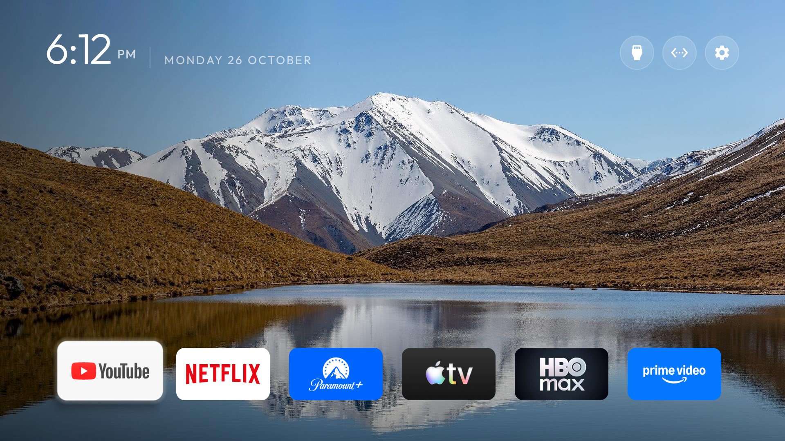
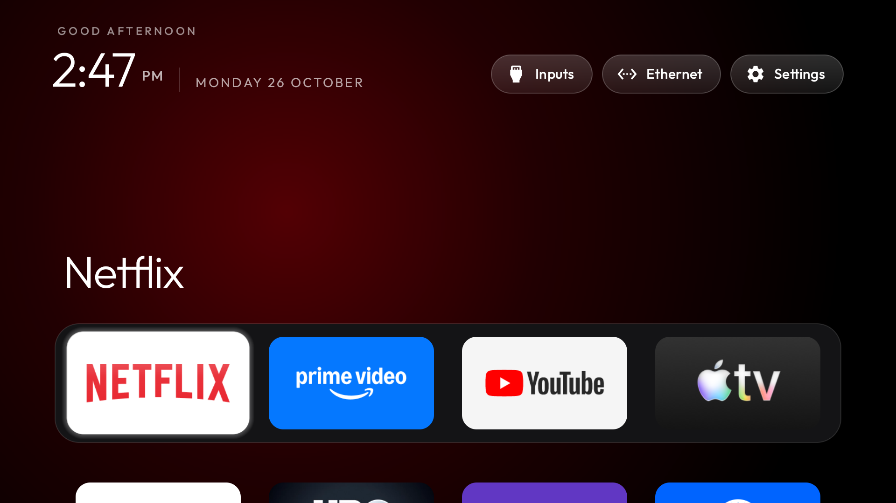
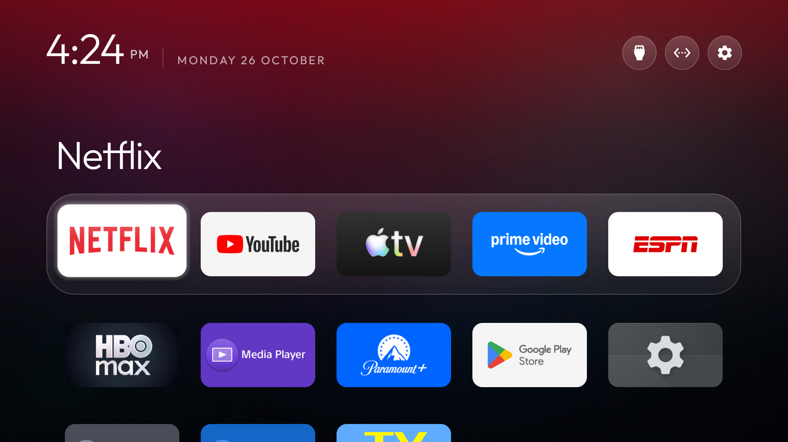

# Sony TV Hack

Debloating and re-skinning a Sony BRAVIA VU1 (Android TV 11) over ADB from a Mac: no root, nothing uninstalled, every change logged with its exact undo.



## What's in here

- **Debloat:** 22 system and preinstalled packages disabled with `pm disable-user` in small batches. RAM and responsiveness were measured before and after, and each batch has an undo script in `backup/`.
- **New Home screen:** the stock launcher is replaced with [cleanyourtv](https://github.com/Gathin23/cleanyourtv)'s launcher. A local fork adds a lock-screen style big clock, a depth effect (the mountains drawn over the clock) and crossfading wallpapers that rotate.
- **Themes:** `themes/appletv` gives a frosted dock in an Apple TV style, and `themes/lockscreen` is a single row of large tiles over rotating wallpapers. Push either one with `scripts/theme-push.sh`.
- **Image tools:** `depth-mask` cuts a landscape's foreground out of its sky for the depth effect, and `sky-shift` moves a photo down and extends the sky so the clock has room.
- **Live monitor:** `scripts/monitor.sh` shows the TV's logcat around each command the scripts send.

| Before | After (Apple TV theme) |
|---|---|
|  |  |

## Setup

Requirements: macOS with the Xcode command-line tools, `adb` (`brew install android-platform-tools`), and the TV with Developer options and network debugging turned on.

```sh
make                       # builds bin/depth-mask, bin/sky-shift
adb connect <tv-ip>:5555
```

The scripts and docs use this TV's address, `192.168.86.90`. Swap in your own.

The launcher and browser APKs aren't in the repo. `downloads/README.md` lists where to get or build each one and its SHA-256. Wallpapers for the rotating theme go in `themes/lockscreen/wallpapers/` (1920×1080 JPGs). That folder is git-ignored, so use your own pictures.

## Docs

- **[CHEATSHEET.md](CHEATSHEET.md):** everyday commands, what changed on the TV, and how to undo it.
- **[DEBLOAT-LOG.md](DEBLOAT-LOG.md):** the full timestamped log of every change, its measurements and its undo.
- **`compare/`:** this TV's state compared with cleanyourtv's recommended list.

## Layout

```
scripts/   shell + Swift tools (theme-push, monitor, depth-mask, sky-shift)
themes/    launcher themes (config.json + wallpapers)
backup/    original package lists, settings, meminfo, undo scripts, screenshots
compare/   package-state diffs against cleanyourtv
logs/      command log and theme experiments
downloads/ APK sources and checksums (APKs themselves not tracked)
```

## Credits

- Launcher and the `appletv` wallpaper come from [cleanyourtv](https://github.com/Gathin23/cleanyourtv) (MIT).
- Browser: [TV Bro](https://github.com/truefedex/tv-bro).
- Lake photo (screenshots, `backup/shelved/`, `logs/theme-variants/`): "Lake Mystery, Canterbury, New Zealand 05" by Michal Klajban, [CC BY-SA 4.0](https://creativecommons.org/licenses/by-sa/4.0/), via Wikimedia Commons. The cut-out `wallpaper_front.png` files are derived from it and shared under the same license.

## Disclaimer

This is a personal project for one TV model. Disabling the wrong system package can break things. Every change here is reversible with ADB, but use it at your own risk.

Original code is under the MIT license (see `LICENSE`). Third-party images and apps keep their own licenses.
